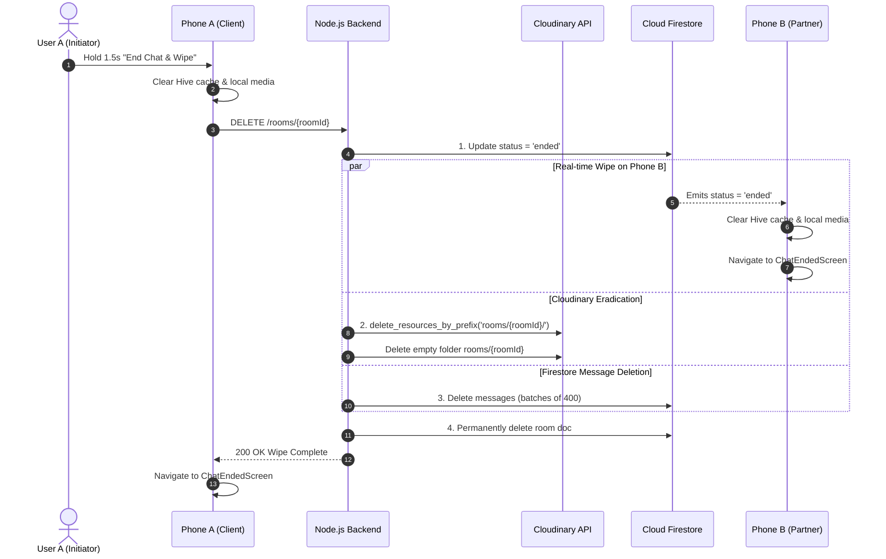

# GhostConv 👻

> **Private, zero-knowledge, 1-to-1 temporary chat rooms with instant, irreversible server and multi-device wipe.**

[](https://flutter.dev)
[](https://dart.dev)
[](https://android.com)
[](LICENSE)
[](#)

---

## ⚡ What is GhostConv?

**GhostConv** is a WhatsApp-like, 1-to-1 chat application designed from the ground up for strict privacy, temporary conversations, and zero digital residue.

1. **User A creates a room** and receives an 8-character single-use security code (e.g. `K7M2-9QXP`).
2. **User B enters the code** to pair into the room.
3. **Once paired, the code is burned immediately** — it can never be used again.
4. Users exchange **real-time end-to-end messages, photos, videos, documents (max 10 MB), and link previews**.
5. **The Wipe (Core Feature)**: When either participant taps **End Chat & Wipe Data** (confirmed with a 1.5-second press-and-hold), **all data** — Firestore documents, Cloudinary media assets, local Hive database caches, and device preview files — is **permanently and irreversibly destroyed** from both phones and the server. If a participant was offline during the wipe, all local data is eradicated immediately upon their next app launch.

---

## 🛠️ Tech Stack & Free-Tier Architecture

GhostConv is engineered strictly to operate within **100% FREE tiers** (no paid Blaze plan required, no Supabase, no Firebase Cloud Storage, no Firebase Cloud Functions).

| Layer | Technology | Details |
|---|---|---|
| **Frontend** | Flutter (Android first, API 26+) | Null-safe Dart, Clean Feature-First Architecture |
| **Design System** | `shadcn_ui` + `google_fonts` + `flutter_animate` | Dark-first (#0B0B14), Sent bubble gradient (#7C5CFF to #5B8CFF), Plus Jakarta Sans & Inter |
| **State Management** | `flutter_riverpod` (v2.6.1) | Reactive StateNotifier providers |
| **Routing** | `go_router` (v17.5.0) | Declarative deep-linking with route guards |
| **Database & Realtime** | Cloud Firestore (Spark plan) | Subcollection streaming, 50k reads/day limit optimizations |
| **Authentication** | Firebase Auth | Email + Password, 5s verification auto-check |
| **Media Hosting** | Cloudinary Free Tier (25 credits) | **HMAC-SHA1 signed uploads** (API secret never bundled in the APK) |
| **Backend** | Node.js + Express + Firebase Admin | Rate limiting (5 wrong attempts = 15m lock), Cloudinary signing, wipe pipeline |
| **Local Cache** | Hive (`hive_flutter`) | 0-latency offline cache, wiped immediately on room exit |
| **Privacy / Anti-Capture** | Native Android `FLAG_SECURE` | Blocks screenshots, screen recording, and blanks Recent Apps switcher |
| **Push Notifications** | FCM + `flutter_local_notifications` | High-priority messages channel `ghostconv_messages` |

---

## 📂 Project Structure

```
ghostconv/
├── android/                   # Android native project (minSdk = 26, FLAG_SECURE channel)
├── backend/                   # Node.js + Express backend
│   ├── src/
│   │   ├── config/            # Firebase Admin & Cloudinary config
│   │   ├── middleware/        # Auth verification, 5-attempt rate limiter, error handler
│   │   ├── routes/            # /rooms, /rooms/join, /rooms/:id (DELETE), /media/sign, /health
│   │   ├── services/          # roomService, wipeService, cloudinaryService
│   │   └── utils/             # Crockford Base32 codeGenerator, SHA-256 hash
│   ├── test/                  # Backend unit tests (Code generation, Hash, Lockout)
│   ├── .env.example           # Backend environment variable template
│   └── package.json
├── firestore.rules            # Participant-only security rules (clients forbidden to write rooms)
├── lib/
│   ├── app/                   # App widget, GoRouter setup
│   ├── core/
│   │   ├── constants/         # AppColors, AppConstants (10MB limits, timeouts)
│   │   ├── network/           # DioClient with auto-attaching Firebase ID tokens
│   │   ├── services/          # LocalCacheService (Hive), NotificationService, SecurityService
│   │   ├── theme/             # AppTheme (ShadTheme + Material3), Typography, ThemeProvider
│   │   └── widgets/           # GhostButton, ChatBubble, CodeInputField, MediaGrid, UploadProgress
│   └── features/
│       ├── auth/              # Signup, Login, Email Verification, Password Strength Meter
│       ├── chat/              # Real-time chat, Presence, Typing debounce, Day grouping, Wipe modal
│       ├── home/              # Active rooms list, Create/Join quick cards
│       ├── media/             # MediaCompressor (78% JPEG), Picker, Viewers (Image, Video player)
│       ├── rooms/             # Create Room (K7M2-9QXP display), Join Room (8-box auto-advance)
│       └── settings/          # Profile editor, Theme mode, FLAG_SECURE toggle, Account deletion
└── test/                      # 17 Unit and widget tests across all features
```

---

## 📋 Numbered Step-by-Step Manual Setup Checklist

Follow these steps to deploy GhostConv on free-tier services.

### 1. Firebase Project Setup (Spark Plan - Free)
1. Navigate to the [Firebase Console](https://console.firebase.google.com/) and create a new project named `GhostConv`.
2. Add an **Android Application**:
   - Android package name: `com.ghostconv.ghostconv`
   - App nickname: `GhostConv`
3. Download the generated `google-services.json` file and place it at:
   ```
   android/app/google-services.json
   ```
4. In the Firebase sidebar under **Build**:
   - **Authentication**: Click **Get Started**, choose **Email/Password**, and enable the first toggle (**Email/Password**). Leave Email link (passwordless) disabled.
   - **Firestore Database**: Click **Create Database**, select a region near your users, and choose **Start in production mode**.
5. Deploy the provided security rules to Firestore:
   - In Firebase Console > Firestore > **Rules**, paste the contents of [`firestore.rules`](file:///F:/Hackathon%20Fest's/Personal%20Chat%20Application/firestore.rules) and click **Publish**.
6. Generate a Firebase Admin Service Account Key:
   - Go to **Project Settings** (gear icon) > **Service accounts** tab.
   - Click **Generate new private key**. Keep this JSON file safe for your backend setup.

---

### 2. Cloudinary Account Setup (Free Tier)
1. Sign up for a free account at [Cloudinary](https://cloudinary.com/) (provides 25 free monthly credits).
2. Go to the Cloudinary Dashboard and note down your credentials:
   - **Cloud Name**
   - **API Key**
   - **API Secret** (Note: Keep this secret strictly on your backend server; it is never included in the Flutter app).

---

### 3. Deploy the Backend (Render or Koyeb Free Tier)
1. Push your repository to GitHub or GitLab.
2. Log in to [Render](https://render.com/) and click **New + > Web Service**.
3. Connect your repository and select the `backend` directory (Root Directory: `backend`).
4. Set the following configuration:
   - **Runtime**: `Node`
   - **Build Command**: `npm install`
   - **Start Command**: `npm start`
   - **Instance Type**: `Free`
5. Under **Environment Variables**, add:
   ```env
   NODE_ENV=production
   PORT=5000
   FIREBASE_PROJECT_ID=<your-firebase-project-id>
   FIREBASE_CLIENT_EMAIL=<your-service-account-client-email>
   FIREBASE_PRIVATE_KEY="<your-service-account-private-key>"
   CLOUDINARY_CLOUD_NAME=<your-cloudinary-cloud-name>
   CLOUDINARY_API_KEY=<your-cloudinary-api-key>
   CLOUDINARY_API_SECRET=<your-cloudinary-api-secret>
   ```
6. Click **Deploy Web Service**. Once deployed, copy your service URL (e.g., `https://ghostconv-backend.onrender.com`).
7. Test the health endpoint in your browser:
   ```
   https://ghostconv-backend.onrender.com/health
   # Returns: {"status":"ok","timestamp":"..."}
   ```

---

### 4. Create an Android Release Keystore & Configure Signing
1. Generate a production release keystore using Java's `keytool`:
   ```bash
   keytool -genkey -v -keystore ghostconv-release-key.jks -keyalg RSA -keysize 2048 -validity 10000 -alias ghostconv
   ```
2. Place `ghostconv-release-key.jks` in the `android/` directory (it is already ignored by `.gitignore`).
3. In `android/`, create a file named `key.properties` with your credentials:
   ```properties
   storePassword=<your-keystore-password>
   keyPassword=<your-key-password>
   keyAlias=ghostconv
   storeFile=../ghostconv-release-key.jks
   ```
   *(If `key.properties` is omitted, the Gradle build will automatically use standard debug signing so test release APKs can still be built immediately).*

---

### 5. Build the Release APK (Split-per-ABI)
GhostConv is optimized for direct APK installation without the Google Play Store.

Build split APKs for minimal download size:
```bash
flutter build apk --release --split-per-abi --dart-define=API_BASE_URL=https://ghostconv-backend.onrender.com
```

This generates three optimized release APKs in `build/app/outputs/flutter-apk/`:
- `app-arm64-v8a-release.apk` (Recommended for modern smartphones, ~24 MB)
- `app-armeabi-v7a-release.apk` (For older 32-bit Android phones, ~21 MB)
- `app-x86_64-release.apk` (For Android emulators & ChromeOS, ~25 MB)

**Every split APK is strictly under the 40 MB threshold.**

To install directly to a connected Android phone:
```bash
adb install build/app/outputs/flutter-apk/app-arm64-v8a-release.apk
```

---

## 🛡️ Security, Privacy & The Wipe Pipeline

### 1. Hash-Only Single-Use Security Codes
- Room security codes are drawn from Crockford's Base32 alphabet (`ABCDEFGHJKLMNPQRSTUVWXYZ23456789`), excluding visually ambiguous characters (`I, O, 1, 0`).
- The backend stores **only the SHA-256 hash** of the code. The raw code is never kept in the database.
- Once User B successfully joins, the code is immediately destroyed (`codeHash = null`), preventing any third party from ever entering.
- Rate limiter locks any user/IP for 15 minutes after 5 consecutive failed code guesses.

### 2. The 4-Step Irreversible Wipe Pipeline
When either user taps **End Chat & Wipe Data** and completes the 1.5-second hold confirmation:


### 3. Screen Capture Protection (`FLAG_SECURE`)
- Enabled by default in **Settings > Privacy**.
- Sets Android's `WindowManager.LayoutParams.FLAG_SECURE` at the OS window level.
- Blocks screenshot shortcuts, third-party screen recorders, and turns the app preview completely blank in the Android Recent Apps switcher.

---

## 🧪 Testing Suite

### Running Flutter Unit & Widget Tests:
```bash
flutter test
```
*Executes all 17 automated tests covering password strength metrics, Crockford code formatting, message serialization, presence encoding, `ChatBubble`, `CodeInputField`, `GhostButton`, `ChatEndedScreen`, hold-to-wipe gesture timing, and `SecurityNotifier`.*

### Running Backend Tests:
```bash
cd backend
npm test
```
*Validates code generation uniqueness across 50 iterations, uppercase normalization, SHA-256 consistency, and the 15-minute lockout rate limiter.*

### Running Static Analysis:
```bash
flutter analyze
```
*Guaranteed zero warnings and zero errors across the entire codebase.*

---

## 📜 License
Distributed under the MIT License. Built with passion for total privacy.
